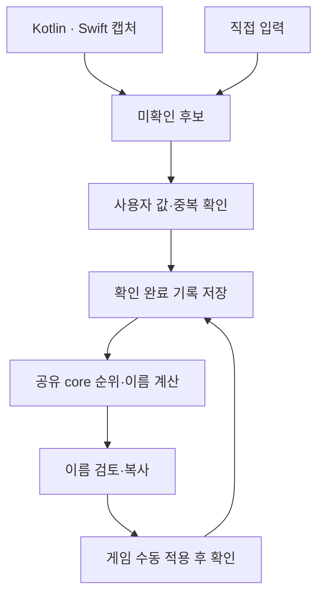

# 아키텍처와 결정 사항

React Native가 Android·iOS의 화면과 TypeScript 계산을 연결하고, 운영체제 API가 필요한 캡처만 네이티브 어댑터로 분리합니다. RN 0.88.1·React 19.3.0의 New Architecture를 사용하며 WebView나 별도 Kotlin·Swift 계산 복제본을 두지 않습니다.

## 데이터 흐름

웹에서는 같은 화면·코어·워크플로를 실행하되 캡처를 제공하지 않습니다. 마지막 단계는 `web-simulation` 입력 연습이고, 기록은 현재 탭의 메모리에만 유지합니다.

## 책임과 경계

| 계층        | 소유 경로                                         | 책임                                                         |
| ----------- | ------------------------------------------------- | ------------------------------------------------------------ |
| 공통 UI     | `apps/mobile/src/screens`, `src/ui`               | 관측·보유·설정, 값 확인, 접근성 라벨, 이름 검토              |
| 컨트롤러    | `apps/mobile/src/controller/useLensController.ts` | 초기 로드, 후보 연결, 저장 후 상태 반영, 작업 중복·오류 관리 |
| workflow    | `packages/workflow`                               | 확인 상태 전이, 스키마 검증, 명시적 중복 연결, 적용 출처     |
| core        | `packages/core`                                   | CP·HP·IV, 종·폼별 순위, 이름 템플릿·보호·오래된 제안 검사    |
| 저장 어댑터 | `apps/mobile/src/storage`                         | 네이티브 AsyncStorage 3 / 웹 메모리, 내보내기·삭제           |
| 캡처 어댑터 | `apps/mobile/android`, `apps/mobile/ios`          | 시스템 동의, 프레임 수명·중지, 제한된 후보 전달              |

`src/native/NativePogoLensCapture.ts`가 Codegen TurboModule 명세입니다. `getState`, `getPendingScans`, 시작·중지·초기화·복사를 Promise API로 제공하며 상태와 후보 응답은 `protocolVersion: 1`의 JSON입니다. JS 경계에서 버전·필드·크기·목록 길이를 검사합니다. 원본 프레임을 JS로 전달하지 않습니다.

## Android 캡처

Android 최소 타깃은 API 29입니다. Kotlin의 `OverlayService`가 플로팅 버튼과 MediaProjection 포그라운드 서비스를 관리합니다. 사용자가 표시 권한과 세션 동의를 직접 허용하며 알림에서 중지할 수 있습니다.

현재 `FrameSink`는 캡처 시각과 프레임 크기만 `CaptureMailbox`에 남깁니다. **Android OCR과 종·IV 자동 채움은 구현하지 않았습니다.** 후보를 열면 값은 수동 입력합니다. 메타데이터 대기열은 최대 20개·24시간이며 이미지 파일은 저장하지 않습니다.

프레임 연타·시간 초과·종료 콜백을 다루고, 지원 버전의 회전과 공유 영역 변경 시 세션을 중지하도록 방어합니다. 실제 권한 창, 앱 단위 공유, 기기별 콜백 순서는 실기기 검증 대상입니다.

## iOS 실시간 캡처

| 코드 경로   | 방식                                                              | 전제                                    |
| ----------- | ----------------------------------------------------------------- | --------------------------------------- |
| iOS 15.1–26 | ReplayKit 시스템 picker → `PogoLensBroadcast/SampleHandler.swift` | 호스트·확장의 같은 App Group, 실제 기기 |
| iOS 27+     | `ModernScreenCapture.swift`의 ScreenCaptureKit picker·SCStream    | iOS 27 SDK가 포함된 빌드, 실제 기기     |

`PogoLensCaptureCoordinator`가 실행 경로를 선택합니다. ScreenCaptureKit이 없는 SDK로 만든 빌드는 iOS 27에서 캡처 불가 상태를 알립니다. 시뮬레이터도 실시간 캡처를 비활성화합니다. 두 경로가 소스에 연결되어 있어도 기기 동작 검증 완료를 뜻하지 않습니다.

공통 `CapturePipeline`은 사용자 시작 세션 안에서 최대 초당 1개 프레임을 Vision으로 분석합니다. CP·HP와 평가 라벨이 함께 있는 경우의 짧은 텍스트만 전달하고, 일반 자유 텍스트는 버립니다. 종과 IV 바를 자동 판독하거나 필드를 자동 확정하지 않습니다. 현재 UI에서 종·IV와 필요한 CP·HP를 직접 확인합니다.

연속된 같은 화면 전달은 세션별 메모리 픽셀 지문으로만 억제합니다. CP·HP 텍스트가 같아도 화면의 IV 바 픽셀이 다르면 별도 후보로 남깁니다. 지문·축소 이미지도 저장하지 않으며, 이것은 포켓몬 개체를 식별·병합하는 기능이 아닙니다.

세션은 최대 10분이며 중지·일시 중지·취소된 OCR 결과를 차단합니다. 음성·영상 녹화 출력을 만들지 않습니다. App Group의 `CaptureIPC-v1`은 제어·상태·최대 12개의 짧은 후보를 공유하고, 후보의 10분 유효기간·파일 크기 제한·파일 보호·백업 제외를 적용합니다. 유효기간이 지난 후보의 반환 제외와 파일의 물리 삭제는 구분하며, 명시적 초기화로 대기 결과를 지웁니다.

## 보유 기록과 이름

- `ScanCandidate`는 휘발성 미확인 후보입니다. 확인한 `LinkedObservation`만 고정 ID의 `ScanRecord`에 연결합니다. 앱 ID는 게임의 고유 개체 ID가 아닙니다.
- 같은 IV만으로 합치지 않습니다. 기존 개체 업데이트 또는 새 개체 추가를 사용자가 고릅니다. 업데이트는 제공하지 않은 값·닉네임·보호 상태를 보존합니다.
- 네이티브 저장에는 확인한 수치·관측 출처·이름 적용 이력을 직렬화합니다. 후보의 OCR 원문·이미지·검토 중 이름 제안은 영구 컬렉션에 넣지 않습니다.
- 미지원 스키마나 손상된 저장을 읽으면 원본을 보존하고 저장을 차단합니다. 원본 내보내기와 명시적 전체 삭제를 제공합니다.
- 순위는 `owned-iv-v1`: 같은 종·폼의 IV 합 → 공격 → 방어 → 체력, 완전히 같은 IV는 공동 순위입니다. fixture 데이터 버전은 `fixture-v1`이며 종은 4종입니다.
- 제안에는 목록·이름·보호·템플릿·종 데이터·정책 버전 스냅샷을 연결합니다. 복사·적용 직전 변경되었다면 다시 검토합니다. 보호 해제는 명시적 동작입니다.
- 복사는 이력을 바꾸지 않습니다. 사용자의 게임 수동 적용 확인은 `user-confirmed`, 웹 연습은 `web-simulation`으로 기록합니다. 게임 상태를 자동 검증하는 기능은 없습니다.

## 빌드와 검증 경계

`npm run build`는 공유 TS 패키지 빌드입니다. Metro의 Android·iOS JS 번들, Gradle의 Android 앱 빌드, Xcode의 호스트·확장 빌드는 각각 별도입니다. 웹은 Vite가 같은 RN 컴포넌트를 React Native Web으로 빌드합니다.

네이티브 서명과 App Group 프로비저닝은 개발자 환경에서 설정합니다. CI의 코드 서명 없는 시뮬레이터 빌드와 단위 테스트로 실시간 캡처·게임 인식·발열을 검증할 수는 없습니다.

## 근거 문서

- [React Native 0.88과 React 19.3](https://reactnative.dev/blog/2026/10/19/react-native-0.88)
- [Apple ScreenCaptureKit](https://developer.apple.com/documentation/screencapturekit)
- [iOS 화면 캡처 공식 샘플](https://developer.apple.com/documentation/screencapturekit/capturing-screen-content-on-ios)
- [Android MediaProjection](https://developer.android.com/media/grow/media-projection)
- [개발 계약](DEVELOPMENT_GUARDS.md) · [보안·기기 검증](SECURITY_REVIEW.md)
